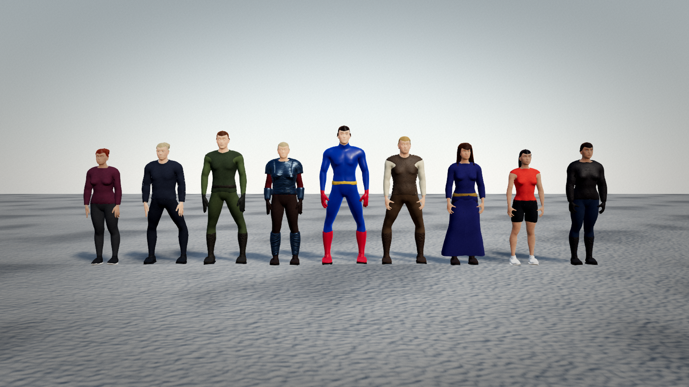
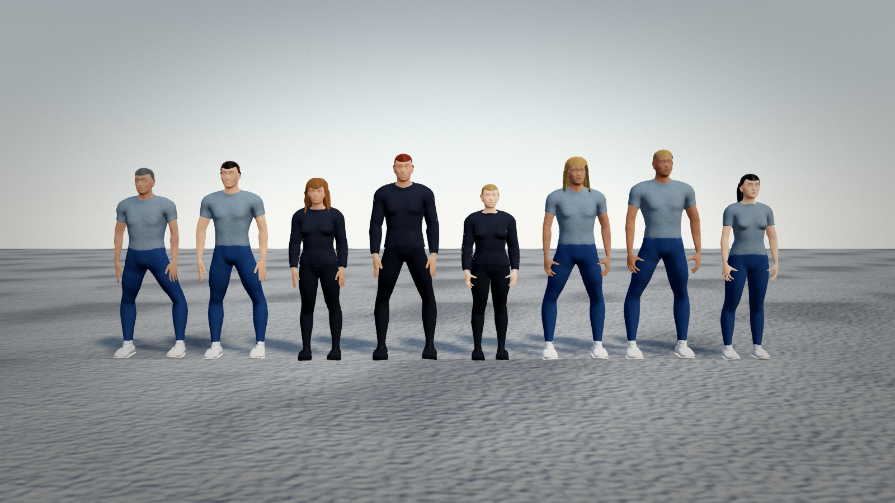
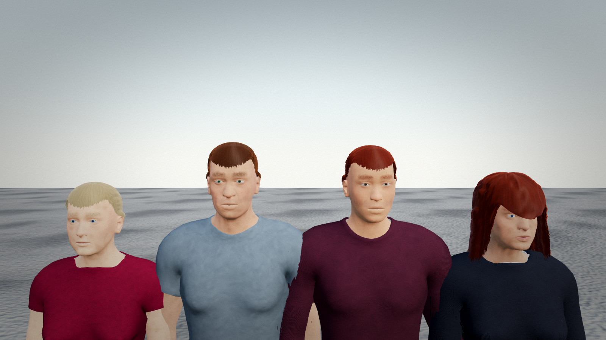
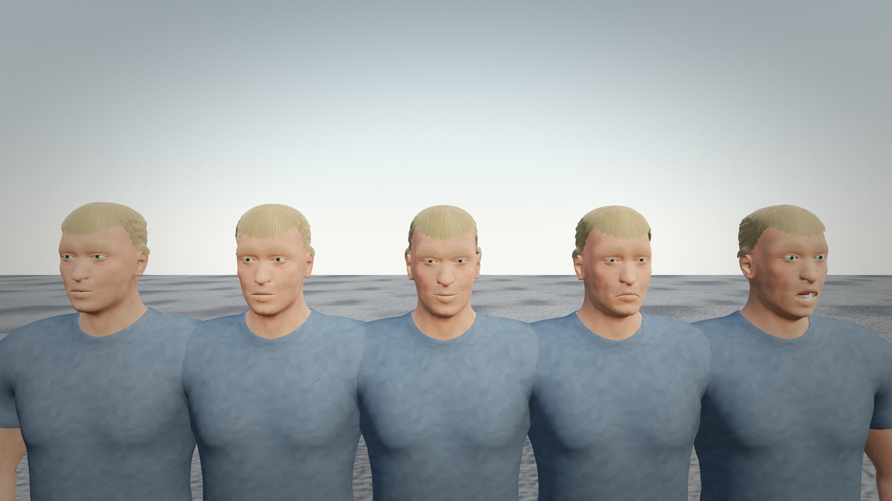
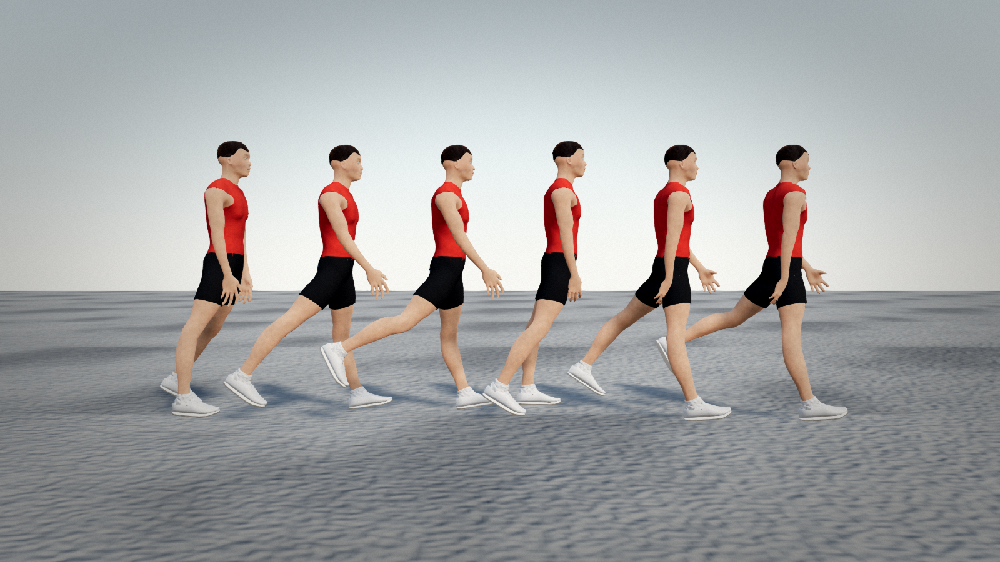
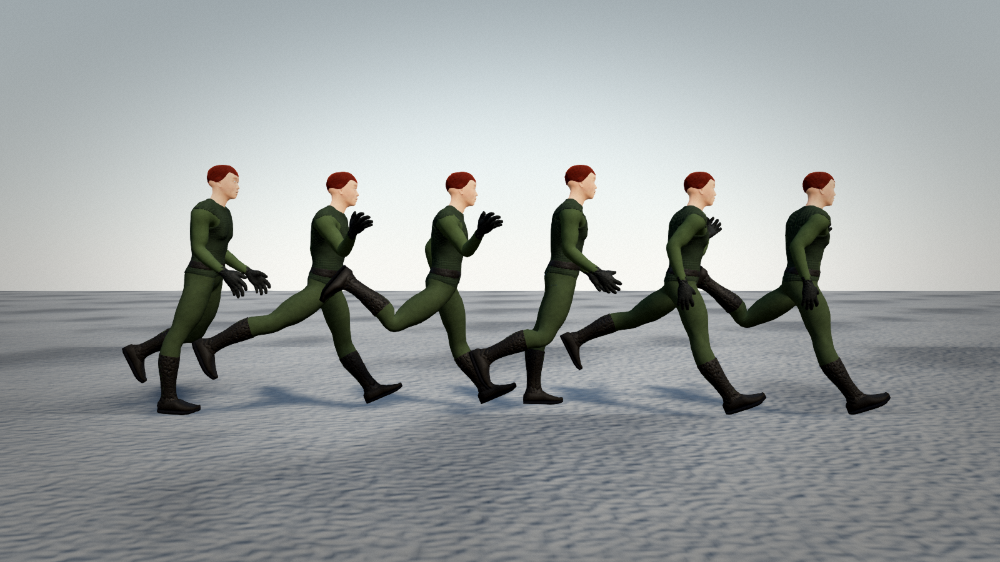
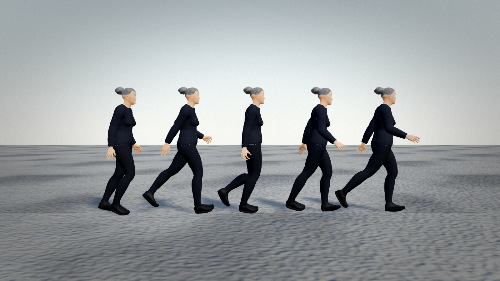

# Character quality benchmark

Generated by `node tools/bench-characters.mjs` on 2026-10-27T19:47:11.171Z (Node v22.22.0). Raw data: [metrics.json](metrics.json).

**11/11 checks passed.**

| Check | Result | Detail |
|---|---|---|
| proportions within anthropometric tolerance | PASS | 40/40 samples, worst score 0.91 |
| stature matches requested heightCm | PASS | max error 0.05 cm over 29 samples |
| stature range plausible for adults (1.40–2.10 m) | PASS | 1.446–2 m |
| no NaN vertices | PASS | all samples |
| skin weights normalised (|Σw−1|<2e-3) | PASS | bad=0 |
| feet on the floor (minY ≈ 0) | PASS | minY -0.006..-0.003 |
| body is centred/symmetric (|meanX| < 1 cm) | PASS | max 0.0000 m |
| deterministic (same seed → identical mesh) | PASS | eba72d58 vs eba72d58 |
| faces differ between seeds (mean head-vertex Δ > 2 mm) | PASS | 3.6 mm mean pairwise |
| full character assembly < 2 s (median) | PASS | 480 ms, 37629 tris |
| inspection sheets render without page errors | PASS | 7/7 |

## Proportions vs. anthropometric norms

Joint heights/segment lengths as a fraction of stature, compared to Winter (2009) joint heights and de Leva (1996) joint-centre segment lengths (norm ± tolerance). Values are deviations from the norm; MakeHuman joint centres are approximations of anatomical landmarks, so tolerances are generous.

| Sample | H (m) | shoulderHeight | hipHeight | kneeHeight | ankleHeight | upperArm | forearm | thigh | shank | shoulderWidth | tris | build ms |
|---|---|---|---|---|---|---|---|---|---|---|---|---|
| *norm* | | 0.818 ±7% | 0.53 ±8% | 0.285 ±12% | 0.039 ±60% | 0.161 ±15% | 0.153 ±15% | 0.241 ±12% | 0.247 ±12% | 0.259 ±30% | | |
| civilian:1 | 1.545 | -4.0% | -3.6% | +0.7% | +18.3% | -11.7% | -11.8% | -6.1% | -1.6% | -20.6% | 37010 | 855 |
| civilian:2 | 1.748 | -2.6% | -0.6% | +3.0% | +14.6% | -9.7% | -10.3% | -2.6% | +1.6% | -24.1% | 36529 | 491 |
| civilian:3 | 1.818 | -1.8% | +2.0% | +4.1% | +4.9% | -8.8% | -5.7% | +1.9% | +4.1% | -12.8% | 36159 | 562 |
| businessperson:1 | 1.899 | -1.9% | +1.5% | +4.2% | +5.6% | -7.8% | -3.5% | +0.7% | +4.1% | -19.2% | 41664 | 551 |
| businessperson:2 | 1.625 | -3.0% | -0.9% | +3.4% | +7.1% | -10.9% | -4.7% | -3.6% | +2.9% | -12.4% | 42394 | 590 |
| businessperson:3 | 1.611 | -3.2% | -0.6% | +4.3% | +7.0% | -9.4% | -10.0% | -3.8% | +3.9% | -21.6% | 41646 | 480 |
| soldier:1 | 1.639 | -3.1% | -2.5% | +0.9% | +10.3% | -9.7% | -10.1% | -4.0% | -0.5% | -21.6% | 42001 | 650 |
| soldier:2 | 1.582 | -3.3% | -1.8% | +2.5% | +7.6% | -9.8% | -10.1% | -4.4% | +1.7% | -20.9% | 42040 | 563 |
| soldier:3 | 1.784 | -2.2% | +1.2% | +2.3% | +5.3% | -8.5% | -3.0% | +2.4% | +1.9% | -14.2% | 41988 | 518 |
| knight:1 | 1.697 | -2.6% | +0.1% | +6.3% | +8.7% | -10.7% | +1.6% | -4.8% | +6.3% | -10.0% | 45065 | 597 |
| knight:2 | 1.691 | -2.8% | +0.2% | +1.1% | +5.0% | -9.3% | -2.2% | +1.5% | +0.6% | -13.4% | 45110 | 435 |
| knight:3 | 1.803 | -1.9% | +1.1% | +6.5% | +6.5% | -10.3% | +1.4% | -2.7% | +6.8% | -14.4% | 45243 | 517 |
| superhero:1 | 1.759 | -2.4% | +1.5% | +5.0% | +5.4% | -10.6% | -0.3% | -0.2% | +5.2% | -7.6% | 37639 | 534 |
| superhero:2 | 1.67 | -2.7% | +0.1% | +5.2% | +8.1% | -8.0% | -11.1% | -3.5% | +4.8% | -25.1% | 38314 | 483 |
| superhero:3 | 1.8 | -2.1% | +2.1% | +6.4% | +6.1% | -11.2% | +1.2% | -0.6% | +6.8% | -5.5% | 37629 | 465 |
| villager:1 | 1.595 | -3.2% | -2.9% | +0.1% | +18.9% | -12.0% | -11.1% | -4.1% | -2.3% | -22.0% | 41602 | 603 |
| villager:2 | 1.596 | -3.5% | -3.4% | -0.2% | +19.0% | -12.0% | -11.3% | -4.7% | -2.6% | -21.7% | 40290 | 494 |
| villager:3 | 1.818 | -1.8% | +2.0% | +4.2% | +4.9% | -8.9% | -5.9% | +1.8% | +4.2% | -12.9% | 40128 | 453 |
| wizard:1 | 1.714 | -2.1% | +0.7% | +9.6% | +5.5% | -12.5% | -4.7% | -7.5% | +10.3% | -9.0% | 33346 | 337 |
| wizard:2 | 1.691 | -2.5% | +0.1% | +3.2% | +4.7% | -10.5% | -5.9% | -1.1% | +3.0% | -15.0% | 37992 | 397 |
| wizard:3 | 1.755 | -2.0% | +0.5% | +8.4% | +5.0% | -12.6% | -4.2% | -6.5% | +8.9% | -14.3% | 38226 | 494 |
| athlete:1 | 1.639 | -3.1% | -2.5% | +0.7% | +9.2% | -9.1% | -10.1% | -3.8% | -0.6% | -21.8% | 36113 | 531 |
| athlete:2 | 1.582 | -3.4% | -1.9% | +2.2% | +6.4% | -9.3% | -10.0% | -4.2% | +1.5% | -20.9% | 36811 | 429 |
| athlete:3 | 1.654 | -2.7% | -1.3% | +1.9% | +7.2% | -7.7% | -11.7% | -2.5% | +1.1% | -25.0% | 36129 | 443 |
| biker:1 | 1.627 | -3.3% | -2.8% | +0.9% | +11.6% | -10.2% | -11.6% | -4.6% | -0.6% | -22.8% | 42361 | 619 |
| biker:2 | 1.673 | -2.5% | -0.6% | +2.9% | +13.2% | -9.2% | -11.4% | -2.3% | +1.5% | -24.9% | 42351 | 510 |
| biker:3 | 1.651 | -3.4% | -1.1% | +4.3% | +9.0% | -10.6% | -10.1% | -4.9% | +3.7% | -22.1% | 42632 | 759 |
| extreme sex=0 m=0 w=0 | 1.448 | -4.5% | -4.1% | +1.6% | +13.4% | -9.6% | -13.6% | -8.3% | -0.1% | -20.5% | 36178 | 400 |
| extreme sex=0 m=1 w=1 | 1.446 | -4.6% | -4.0% | +2.0% | +13.8% | -9.1% | -13.7% | -8.5% | +0.3% | -20.9% | 36186 | 337 |
| extreme sex=0 m=0 w=1 | 1.446 | -4.6% | -4.0% | +2.0% | +13.8% | -9.1% | -13.6% | -8.5% | +0.3% | -20.9% | 36260 | 448 |
| extreme sex=0 m=1 w=0 | 1.446 | -4.6% | -4.0% | +2.0% | +13.8% | -9.1% | -13.7% | -8.5% | +0.3% | -20.9% | 36168 | 429 |
| extreme sex=1 m=0 w=0 | 1.576 | -3.4% | -0.7% | +2.9% | +9.3% | -10.9% | -3.4% | -2.5% | +2.2% | -2.4% | 36115 | 428 |
| extreme sex=1 m=1 w=1 | 1.576 | -3.4% | -0.7% | +2.9% | +9.3% | -10.9% | -3.4% | -2.5% | +2.2% | -2.4% | 36253 | 416 |
| extreme sex=1 m=0 w=1 | 1.576 | -3.4% | -3.8% | +3.0% | +9.6% | -10.9% | -3.4% | -9.5% | +2.1% | -2.4% | 36296 | 435 |
| extreme sex=1 m=1 w=0 | 1.576 | -3.5% | -0.9% | +1.8% | +9.3% | -10.9% | -3.6% | -1.8% | +1.0% | -2.5% | 36212 | 407 |
| height 150cm | 1.5 | -4.1% | -3.1% | +2.7% | +11.9% | -9.5% | -12.8% | -7.3% | +1.4% | -22.3% | 36150 | 449 |
| height 200cm | 2 | -1.3% | +3.4% | +5.2% | +5.7% | -7.3% | -3.6% | +3.7% | +5.3% | -12.5% | 36209 | 437 |
| age 0.5 | 1.582 | -3.5% | -0.5% | +1.7% | +10.1% | -10.4% | -0.9% | -0.7% | +0.8% | -1.1% | 36165 | 406 |
| age 0.875 | 1.582 | -3.5% | -0.5% | +1.7% | +10.1% | -10.4% | -0.9% | -0.7% | +0.8% | -1.1% | 36165 | 419 |
| age 1 | 1.582 | -3.5% | -0.5% | +1.7% | +10.1% | -10.4% | -0.9% | -0.7% | +0.8% | -1.1% | 36165 | 412 |

## Performance

Median geometry build 30 ms; median full assembly (morph + 512 px skin bake + garments + hair) 480 ms; median 37629 triangles per dressed character. Node.js CPU timings (geometry + 512px skin bake + clothing + hair); browser timings are similar.

## Visual inspection sheets

Rendered with the sandbox scene (`sandbox/humans.html`) at quality=medium in headless Chromium/SwiftShader.

### Archetype lineup (9 archetypes, seeded)

### Same archetype, 8 seeds

### Head/shoulder portraits

### Expressions: neutral, happy, angry, sad, surprised

### Retargeted procedural walk, 6 phases (side view)

### Retargeted procedural run, 6 phases

### CC0 BVH mocap (MakeHuman walk) retargeted, 5 phases

## Honest assessment

These characters are built from the CC0 MakeHuman base mesh and morph targets with procedural skin, garments and hair. They are anatomically proportioned and individually varied, but they are **not photorealistic**: hair is a textured shell rather than strands, garments are body-offset shells without cloth simulation, skin uses a baked albedo with a wrap-lighting SSS approximation, and there are no scanned textures. See LIMITATIONS.md.
