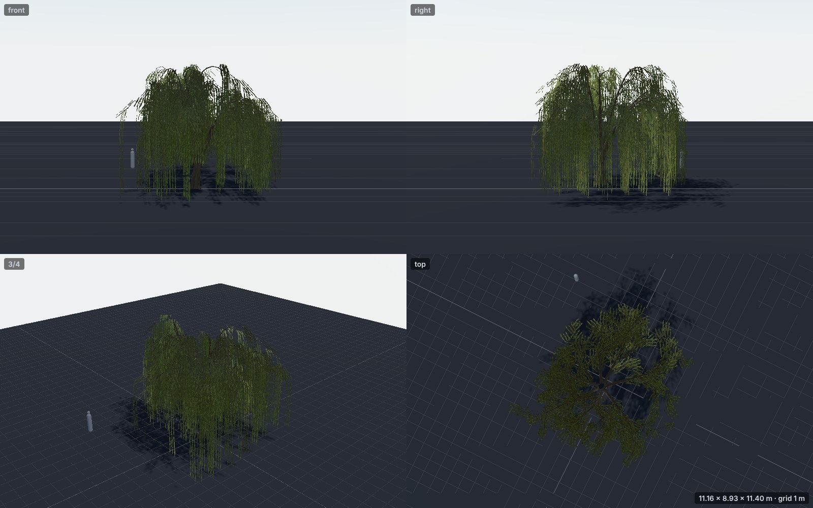
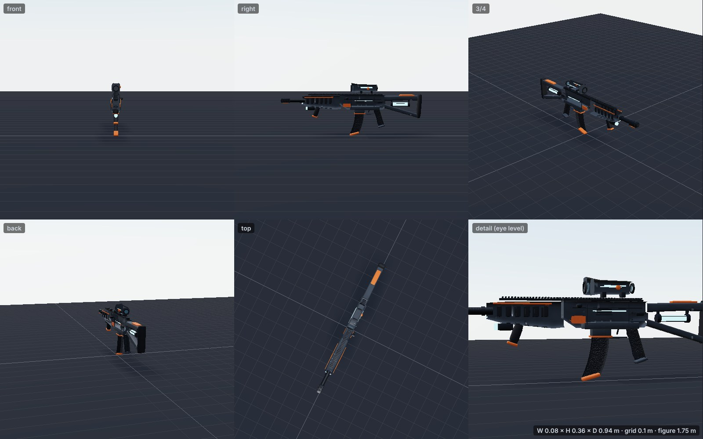
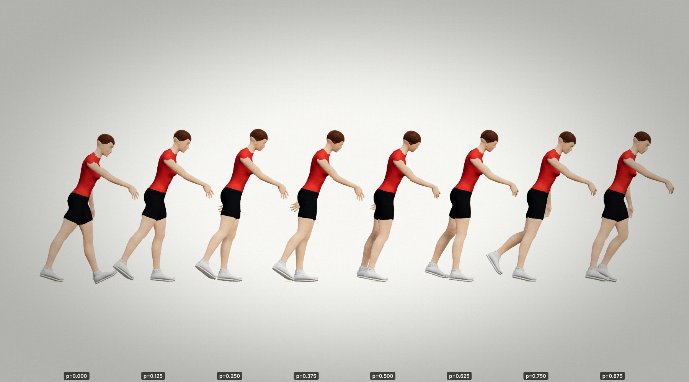

# Blind skill tests

A fresh agent (the `3d-artist` role) gets **only** the skill documentation
(`references/modeling.md`, the example scripts) and the tools. It is not told about any built-in
generator for the requested object. It must produce the asset itself through the review loop.

## Test 1: weeping willow (2026-10-28)

The agent produced `skills/gameforge/models/willow.model.js` (now kept as an example).

| Measure | Result |
|---|---|
| Review rounds | 5 (blockout → strands → height/colour → dome silhouette + budget → density/top cover) |
| Final metrics | 9 440 triangles, 2 meshes, 2 materials, W 11.2 × H 8.9 × D 11.4 m, build 183 ms |
| Checks | all pass |
| Seed variation | verified: seed 2 gave a 9.8 m tree with a more upright crown |

**Remaining issues the agent self-reported:**
- The crown reads dark from the top.
- The foliage colour is olive under studio light.
- The curtain is somewhat uniform.
- The trunk lacks root flare.
- Cards are not volumetric.

**Skill gaps found → fixed in the same session:**
- card UV orientation undocumented;
- no ribbon/strip helper (`cardStrip`);
- no curve helper (`curve`);
- no per-mesh triangle breakdown;
- unlabeled size axes;
- `pbr` options undocumented;
- open-edge warning on tubes;
- no pendulous-growth recipe;
- `RNG` methods undocumented;
- review sheet: scale figure hidden, top view dark, no eye-level detail view (now 6 views with
  a hemisphere fill light);
- no "fine detail is a texture" budget guidance.

## Test 2: sci-fi assault rifle (2026-10-28)

The agent produced `skills/gameforge/models/scifi-rifle.model.js` (kept as an example).

| Measure | Result |
|---|---|
| Review rounds | 5 + 1 (blockout → shapes → sci-fi identity → silhouette → surface detail) |
| Final metrics | 11 316 triangles, 6 meshes, 6 materials, W 0.08 × H 0.36 × D 0.94 m, 0 open edges |
| Checks | all pass |
| Sockets | `grip`, `muzzle`, `offHand`, `sight` (grip at the origin, muzzle +Z) |

**Gaps found → fixed:**
- the 1.75 m figure dominated small props (now hidden automatically, plus `--no-ref`);
- the detail view looked down the muzzle (it now looks at the broad side, plus `--yaw`);
- `floating` was undocumented;
- MeshBuilder lost the open flag, and `tube` was not marked open;
- no builder-axis table;
- no inset/vent recipe;
- no socket convention (`K.socket`);
- no weapon sizes or budget;
- no polymer/rubber materials (`K.polymer`, `K.rubber`, `K.chrome`, `K.anodized`, `K.ceramic`);
- `glass`/`emissive` signatures undocumented.

## Test 3: zombie walk animation (2026-10-28)

The agent produced `skills/gameforge/anims/zombie-walk.anim.js` (kept as an example, now with
`groundFeet: true`).

| Measure | Result |
|---|---|
| Review rounds | 5 (first pass → dragged-toe solver → side effects → posture/arms → limp buckle + footfall events) |
| Final checks | all pass. With `groundFeet`: sink 0 cm, maximum float 1.2 cm (was 3.5 cm) |

**Gaps found → fixed:**
- **Wrong documentation:** the `foot` sign (+ is toes down).
- `ease` was unclamped (caused huge seam and knee failures);
- the sheet phase sampling was mis-described;
- `locomotion` units and `relaxed` signs were undocumented;
- no foot-planting helper (`groundFeet`);
- checks didn't say where a problem was (they now name the phase and foot, and the JSON has a
  per-frame table);
- grounding check too loose (now ≤ 3 cm every frame);
- small figures and a misleading perspective camera (now orthographic, 1800 × 1000, phase
  labels and contact discs).

## Test 4: sound design (2026-10-28)

The agent produced three sounds: a car door, an explosion and a healing chime. All passed in 3–4
rounds each. They were verified by analysis only; **nobody listened to them**. All three are kept
as examples in `skills/gameforge/sounds/`.

**Gaps found → fixed:**
- voice signatures undocumented (`slide` is a target in Hz, envelope shapes, the usable `_pluck`
  range);
- no distortion, delay or filter helpers (now `e.saturate`, `e.delay`, `e.filter`);
- whole-file centroid only (now per-segment centroids, band split, spectral peaks and a click
  detector);
- renders weren't deterministic (now `--seed`);
- sheet had no dB colour bar or zoom (both added, plus denser time labels);
- CLI crashed on `--help`;
- the tail message was misleading;
- no peak or centroid targets per category.
