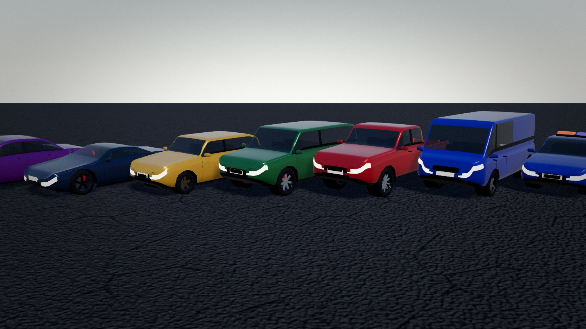
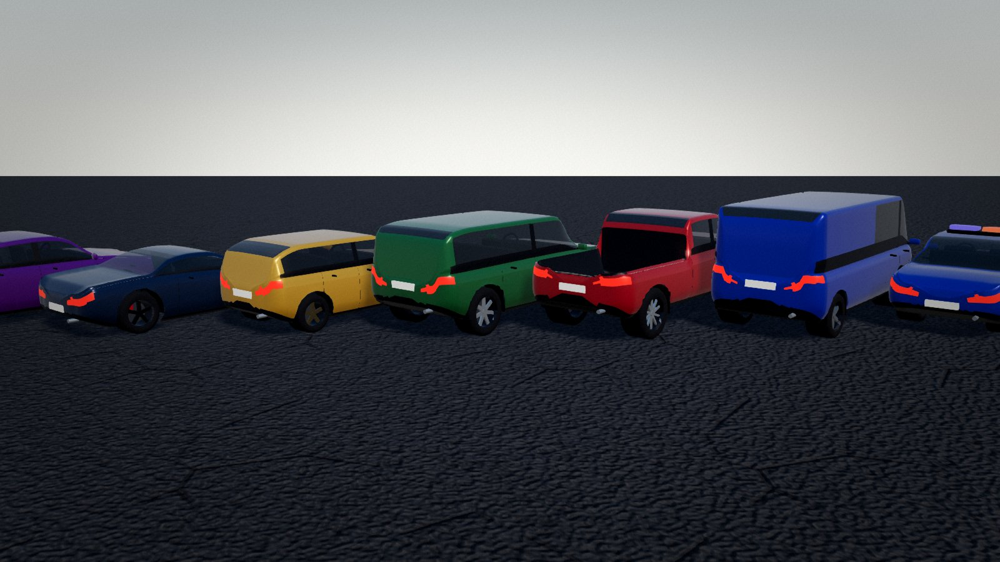
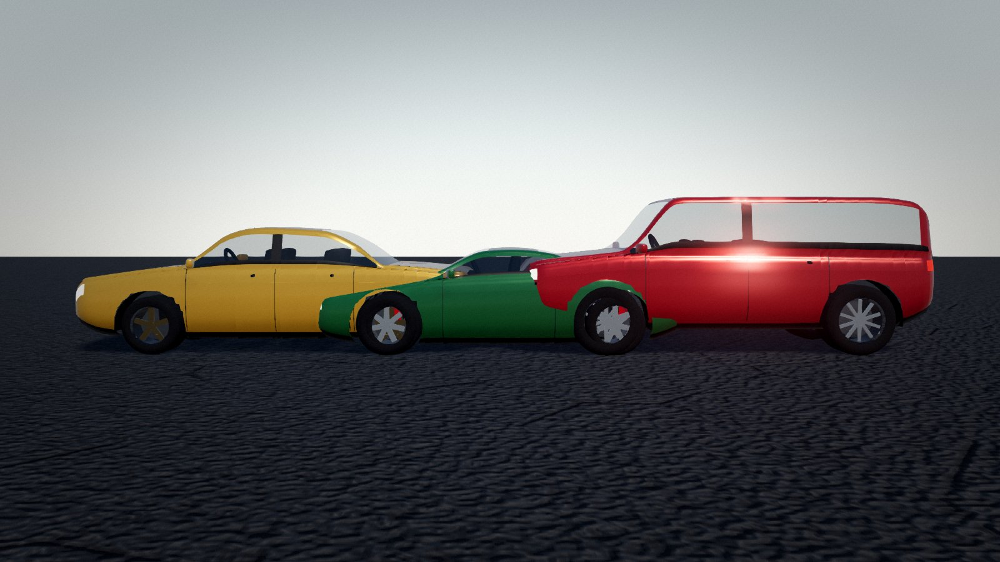
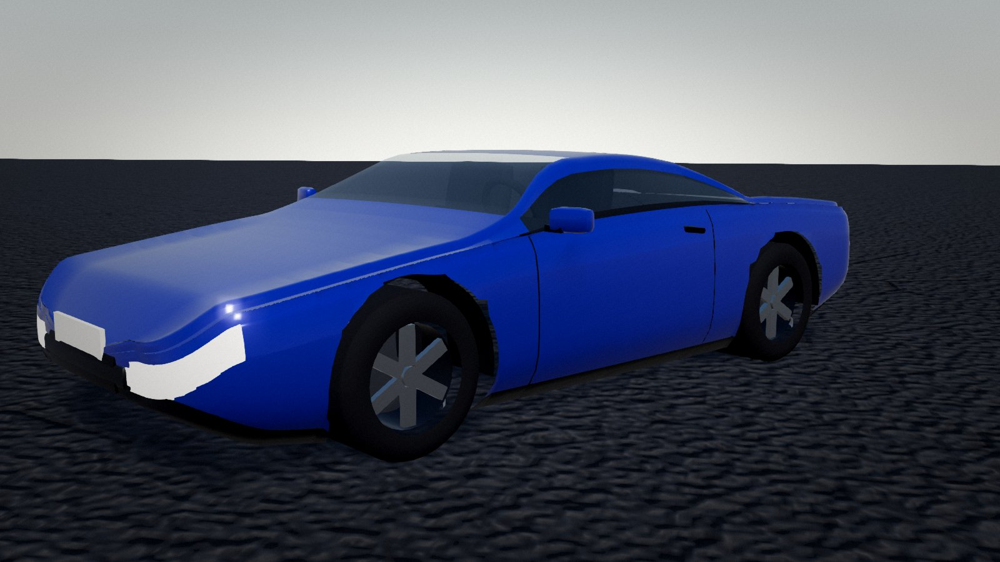

# Vehicle quality benchmark

Generated by `node tools/bench-vehicles.mjs` (2026-10-27T20:22:00.597Z). Raw data: [metrics.json](metrics.json).

**7/7 checks passed.**

| Check | Result | Detail |
|---|---|---|
| no NaN vertices | PASS | 18 builds |
| 4 wheels touching the ground plane | PASS | pivot.y − radius ≈ 0 |
| body shell matches declared dimensions (±6 %) | PASS | sedan:1.85×1.47×4.77 sports:1.95×1.21×4.52 coupe:1.95×1.31×4.67 hatchback:1.8×1.5×4.17 suv:2×1.82×4.87 truck:2×1.87×5.47 van:2×2.12×5.07 police:1.85×1.47×4.77 taxi:1.85×1.47×4.77 |
| every body has glass and lamps | PASS | material groups non-empty |
| triangle budget: high ≤ 30k, low ≤ 16k | PASS | high 24464, low 14388 |
| build time ≤ 150 ms | PASS | max 79 ms |
| inspection renders without page errors | PASS | 4 images |

| Type | Detail | Triangles | Build ms | Size (W×H×L m) |
|---|---|---|---|---|
| sedan | high | 24320 | 79 | 1.85 × 1.47 × 4.77 |
| sedan | low | 14088 | 18 | 1.85 × 1.46 × 4.77 |
| sports | high | 23028 | 22 | 1.95 × 1.21 × 4.52 |
| sports | low | 13328 | 13 | 1.95 × 1.21 × 4.52 |
| coupe | high | 23152 | 25 | 1.95 × 1.31 × 4.67 |
| coupe | low | 13380 | 10 | 1.95 × 1.31 × 4.67 |
| hatchback | high | 24296 | 17 | 1.8 × 1.5 × 4.17 |
| hatchback | low | 14104 | 15 | 1.8 × 1.5 × 4.17 |
| suv | high | 24224 | 19 | 2 × 1.82 × 4.87 |
| suv | low | 14032 | 13 | 2 × 1.82 × 4.87 |
| truck | high | 24228 | 15 | 2 × 1.87 × 5.47 |
| truck | low | 14388 | 10 | 2 × 1.87 × 5.47 |
| van | high | 24380 | 15 | 2 × 2.12 × 5.07 |
| van | low | 14108 | 10 | 2 × 2.12 × 5.07 |
| police | high | 24464 | 14 | 1.85 × 1.47 × 4.77 |
| police | low | 14232 | 9 | 1.85 × 1.46 × 4.77 |
| taxi | high | 24320 | 15 | 1.85 × 1.47 × 4.77 |
| taxi | low | 14088 | 10 | 1.85 × 1.46 × 4.77 |

### All types, front three-quarter

### All types, rear three-quarter

### Side profiles (sedan, sports, SUV)

### Close-up: wheels, lamps, glass, interior

## Honest assessment

Profile-driven procedural bodies: continuous smooth shells with flush glass, pillars, door seams, wrap-around lamps, cut wheel arches with liners, interiors and detailed wheels. They read clearly as car classes but are **not** production car models: no body-panel creases or sculpted surfacing beyond the profile curves, lamps are emissive patches rather than modelled optics, and paint uses a clearcoat material without baked AO.
